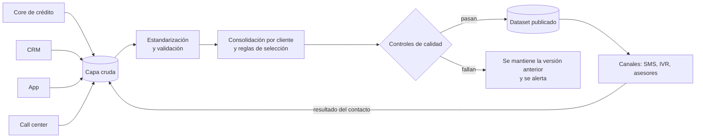

# Ejercicio 1. Dataset de teléfonos de clientes

## El problema

En una compañía como Tuya el teléfono de un cliente no vive en un solo lugar. Se captura al originar el crédito en el almacén aliado, se actualiza en la app, el call center lo corrige cuando el cliente llama y a veces llega desde campañas o desde terceros. Cada fuente tiene sus propios errores: números con espacios o prefijos viejos, campos obligatorios llenados con 3000000000 para poder avanzar, el celular del asesor repetido en los formularios de decenas de clientes, fijos de siete dígitos que quedaron así desde antes del cambio de numeración.

Por eso, para mí un dataset confiable no es el que tiene un teléfono por cliente. Es el que, para cada número, dice de dónde salió, cuándo se vio por última vez, si alguna vez se comprobó que funciona y si el cliente autorizó que lo contacten por ahí. Con esa información, decidir cuál es el teléfono principal se vuelve una regla explícita que se puede revisar y cambiar.

## Qué contiene

La tabla central tiene una fila por cada par cliente y teléfono. Encima de ella hay una vista con el mejor teléfono de cada cliente, que es la que consumen los canales.

| Campo | Para qué sirve |
|---|---|
| `id_cliente` | Llave del cliente en el core |
| `telefono_e164` | Número normalizado, por ejemplo `+573001234567` |
| `telefono_original` | Lo que llegó de la fuente, sin tocar, para auditoría |
| `tipo` | móvil o fijo |
| `fuente` | sistema de origen (core, CRM, app, call center, ...) |
| `fecha_primera_vez`, `fecha_ultima_vez` | cuándo se vio el número en esa fuente |
| `estado_validacion` | válido, sospechoso o inválido, con el código de la regla que lo marcó |
| `fecha_ultimo_contacto_exitoso` | viene de la retroalimentación de los canales |
| `autoriza_contacto` | consentimiento vigente y para qué canales |
| `es_principal` | resultado de las reglas de selección |
| `id_carga`, `fecha_proceso` | trazabilidad de la corrida que generó la fila |

La tabla guarda historia (tipo 2): cuando un número cambia de estado no se sobrescribe, se cierra la fila anterior y se abre una nueva. Así, si un área pregunta por qué en marzo se llamó a un número que ya estaba malo, la respuesta está en los datos.

## Cómo se construye

La capa cruda guarda lo que llega de cada fuente tal cual, particionado por fecha de carga. Nunca se modifica, y eso permite reprocesar si una regla cambia. Cada fuente tiene un contrato acordado con su dueño, que define qué columnas envía, con qué tipos, cada cuánto y quién responde si algo cambia. Si una entrega no cumple el contrato (falta una columna, cambió un tipo, llegó vacía), la carga de esa fuente se detiene ahí y no contamina lo demás.

Antes de consolidar hay que saber que el cliente del CRM y el del core son la misma persona. El cruce se hace por tipo y número de documento normalizados, y no por nombre. Los registros que no cruzan quedan aparte para revisión y no se descartan en silencio.

En la estandarización se quitan espacios, guiones, paréntesis y prefijos como `+57`, `57`, `0057` o `03`, y luego se clasifica el número según el plan de numeración colombiano. Un móvil tiene diez dígitos y empieza por 3. Un fijo, desde el cambio de numeración que la CRC aplicó en 2021, tiene diez dígitos y empieza por 60 seguido del indicativo regional (601 para Bogotá, 604 para Antioquia, etc.). Si llega un fijo de siete dígitos y se conoce la ciudad del cliente, se le puede anteponer el indicativo que corresponde. Si no se conoce, queda marcado como incompleto y no se inventa nada.

Cuando el número pasa el formato, se revisa si es plausible. Algunos números se ven bien y aun así no sirven. Los placeholders evidentes se marcan como inválidos. Lo demás queda como sospechoso, porque puede ser un número real, y deja de competir por ser principal mientras no tenga un contacto exitoso que lo respalde.

| Regla | Ejemplo |
|---|---|
| Dígitos repetidos o secuencias | 3000000000, 3111111111, 3123456789 |
| Número compartido por muchos clientes | el mismo celular en más de N clientes sin relación familiar conocida |
| Números de la propia compañía o de aliados | líneas de servicio al cliente, teléfonos de almacenes |
| Rangos no asignados | prefijos que no aparecen en la numeración asignada que publica la CRC |

El umbral de la regla de números compartidos se calibra con los datos. Un número en dos o tres clientes suele ser una familia; en cuarenta, casi siempre es un asesor o un almacén.

## Cómo se elige el teléfono principal

Cuando un cliente tiene varios números válidos, se ordenan con estos criterios, en este orden:

1. Contacto exitoso reciente, ya sea una llamada contestada, un SMS entregado o un OTP validado.
2. Confiabilidad de la fuente. La app y el call center, donde el cliente confirma el dato él mismo, pesan más que un formulario de originación.
3. Fecha de última actualización.
4. Preferencia por móvil sobre fijo, porque permite SMS y WhatsApp.

Las reglas quedan en código versionado y no en la cabeza de alguien. Cambiar el orden es un pull request como cualquier otro.

## Mantenimiento

El dataset se degrada solo. La gente cambia de número, las líneas se reasignan y un número que funcionaba hace un año hoy puede ser de otra persona. Lo que lo mantiene vivo es la retroalimentación de los canales. Cada vez que un asesor marca "número equivocado", un SMS rebota o un cliente valida un OTP en la app, ese evento vuelve a la capa cruda como una fuente más y cambia el estado del número en la siguiente corrida.

También conviene una regla de vencimiento. Un número sin contacto exitoso en, digamos, 18 meses pasa a "sin confirmar" y deja de ser principal si el cliente tiene otro con mejor evidencia.

## Privacidad y regulación

Los teléfonos son datos personales y su uso en Colombia está regulado. La Ley 1581 de 2012 exige autorización del titular y respetar la finalidad para la que se dio. La Ley 2300 de 2023 limita los canales, los horarios y la frecuencia con que una entidad puede contactar a un cliente para cobranza. Para mensajes comerciales hay que cruzar contra el Registro de Números Excluidos de la CRC. Por eso el consentimiento es un campo del dataset y no un filtro que cada área aplica por su cuenta.

En lo técnico, el acceso a la tabla con números completos se limita a los roles que lo necesitan. Fuera de producción los números van enmascarados o se reemplazan por datos sintéticos.

## CI/CD

Aquí hay que separar dos cosas que se suelen mezclar: el código del pipeline y los datos que pasan por él. El código cambia cuando alguien lo modifica. Los datos cambian en cada corrida, aunque nadie haya tocado nada.

**El código** (transformaciones SQL, reglas de validación, configuración) vive en un repositorio y cada cambio entra por pull request. En CI se corren el lint de SQL y de Python, las pruebas unitarias de las reglas de normalización con casos conocidos (un número con `+57`, un fijo viejo, un placeholder) y una ejecución completa del pipeline sobre un conjunto de datos sintéticos que nunca contiene teléfonos reales. Si algo falla, el cambio no se puede integrar. Después del merge, el despliegue pasa por desarrollo, calidad y producción. Producción requiere aprobación manual de alguien distinto al autor del cambio. En [ci_dataset_telefonos.yml](ci_dataset_telefonos.yml) dejé un workflow de GitHub Actions como referencia de cómo se vería.

**Los datos** se controlan en cada ejecución con el patrón write-audit-publish. El pipeline escribe el resultado en una tabla o partición de preparación, corre los controles de calidad sobre ese resultado y solo si pasan lo publica, cambiando la vista que leen los consumidores para que apunte a la nueva versión. Algunos de los controles son:

| Control | Ejemplo de umbral |
|---|---|
| Volumen | el número de clientes no cae más de 2 % frente a la corrida anterior |
| Unicidad | ningún cliente tiene más de un teléfono principal |
| Validez | el porcentaje de números válidos no baja más de 1 punto |
| Frescura | todas las fuentes llegaron con fecha del día |
| Integridad | todo `id_cliente` existe en el maestro de clientes |

Si un control crítico falla, no se publica, los consumidores siguen viendo la versión anterior y el equipo recibe una alerta. Si el problema aparece después de publicar, el rollback consiste en volver a apuntar la vista a la versión anterior, porque cada corrida queda guardada con su `fecha_proceso`.

## Herramientas

El diseño no depende de una herramienta en particular. Como el enunciado menciona Impala, asumo un entorno tipo Cloudera, donde esto se puede montar con tablas particionadas en Hive o Impala, un orquestador como Airflow, las transformaciones en SQL versionado (dbt tiene adaptador para Impala) y los controles de calidad como pruebas de dbt o con Great Expectations. En la nube el esquema es el mismo y solo cambian los nombres de los servicios.

## Operación

Cada corrida deja registro de cuántas filas leyó de cada fuente, cuántas pasaron cada regla, cuánto tardó y qué versión del código se usó. Esa información alimenta el tablero del ejercicio 2 y sirve para responder, sin ponerse a investigar, qué pasó en una fecha determinada.
